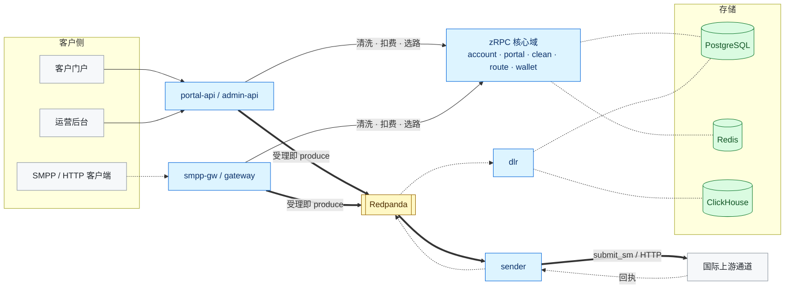

<div align="center">

# 🐦 Tern

### 纯国际商业短信（A2P SMS）平台

<sub>代号取自北极燕鸥（<i>Sterna paradisaea</i>）：每年在两极之间往返，只飞国际航线。</sub>

<br/>


[产品线](#-产品线) · [Tern 平台](#-tern--国际-a2p-短信平台) · [Tern Shadow](#-tern-shadow--影子上游) · [贡献看板](#贡献看板)

</div>

---

## 🧭 产品线

<table>
<tr>
<td width="50%" valign="top">

### 🐦 Tern

面向客户的**国际 A2P 短信平台**：接入 → 号码清洗 → 通道路由 → 计费 → 回执与报表。

📦 [`sms`](https://github.com/ternsms/sms) · go-zero 13 服务 + 门户 + 后台

</td>
<td width="50%" valign="top">

### 🌑 Tern Shadow

**不是短信平台**：对老系统扮演一家上游 SMSC，在中间做短链替换与归因，再转发给真上游。

📦 [`legacy-smpp-proxy`](https://github.com/ternsms/legacy-smpp-proxy) · 6 服务，老系统零改造

</td>
</tr>
</table>

> [!NOTE]
> 两者代码同源（Shadow 从 `sms` 拆出并大幅裁剪），定位、部署与演进各自独立。`sms` 与 `legacy-smpp-proxy` 为私有仓库，本页是公开概览；[`.github`](https://github.com/ternsms/.github) 仓库承载本主页与每日贡献看板。

---

## 🐦 Tern · 国际 A2P 短信平台

Tern 是一个**带号码清洗能力的国际短信中转平台**：客户提交短信，平台完成名单风控、通道下发、回执归一、计费结算与统计报表的全链路，架构按**日千万级发送量**设计。

| 立项约束 | |
|---|---|
| 🌐 **纯国际** | 协议仅 SMPP 3.4 + HTTP，通道仅国际服务商，不含国内运营商能力 |
| 🆕 **全新 API** | 不兼容老平台对外 API，无迁移包袱 |
| 🛡 **名单类风控** | 内容审核、词库 / 模板类策略暂缓 |

### 消息主线

```
客户（门户网页发送 · SMPP 3.4 · HTTP API）
  → 号码清洗   全内存 roaring bitmap + 不可变快照，零存储 IO
               E.164 规范化 · 黑名单（客户 / 系统 / 全局）· 空号库 · 异常号码 · 白名单池
  → 扣费       客户级预付钱包，按分段提交即扣，幂等账本
  → 下发       sender：产品绑定通道，统一限速与并发；上游 SMPP bind 池 / HTTP 驱动
  → 回执       dlr：分区独占状态机，终态不可变 → 明细 · 报表 · 对客回执
```

### 架构



<details>
<summary><b>13 个服务一览</b></summary>

| 服务 | 类型 | 职责 |
|---|---|---|
| `portal-api` / `admin-api` | go-zero API | 门户与后台 BFF，独立部署与权限体系 |
| `gateway` | go-zero API | 对外 HTTP API：API Key + HMAC 鉴权、提交 / 查询 |
| `smpp-gw` | 常驻服务 | 客户 SMPP 3.4 server：bind、submit_sm、deliver_sm 回传 |
| `clean-rpc` | zRPC | 清洗核：bitmap 名单 + 白名单池 + 运营商判定快照 |
| `account-rpc` | zRPC | 客户 / 产品 / 凭证 / SenderID 主数据 |
| `portal-rpc` | zRPC | 门户用户域：登录、邀请、找回、恢复码、登录日志 |
| `wallet-rpc` | zRPC | 客户级钱包与幂等账本、余额预判、对账 |
| `route-rpc` | zRPC | 产品到通道的路由决策 |
| `sender` | worker | 消费提交 topic，通道限速与并发、上游 bind 池与 HTTP 驱动 |
| `dlr` | worker | 回执归一化、分区独占状态机、changelog 恢复、终态发布 |
| `shortlink` | go-zero API | 平台短链：生成 / 替换、302 归因、高点击池入池 |
| `report` | API + 定时 | ClickHouse 报表、日对账、点击率补发控制器 |

</details>

### 关键机制

<table>
<tr>
<td>🔒 <b>终态不可变</b><br/><sub>迟到 / 重复回执不重复推进或结算</sub></td>
<td>📒 <b>幂等账本</b><br/><sub>扣费与消息明细对账</sub></td>
<td>🧩 <b>分区独占状态机</b><br/><sub>Redpanda changelog 恢复</sub></td>
</tr>
<tr>
<td>🗂 <b>bitmap 圈选</b><br/><sub>亿级明细查询</sub></td>
<td>📸 <b>不可变配置快照</b><br/><sub>版本信号热更新</sub></td>
<td>✍️ <b>唯一写者原则</b><br/><sub>每张表只有一个服务写</sub></td>
</tr>
</table>

**金额**全链路「万分之一 USD」定点 BIGINT · **消息状态** `ACCEPTED → SUBMITTED → DELIVRD | UNDELIV | EXPIRED | REJECTD`，平台拦截记 `BLOCKED` · **安全基线**：密钥零硬编码、凭证 AES-256-GCM 落库、SSRF 防线、内部端点强鉴权、后台强制 2FA。

### 路线图

<sub>✅ 已达成 · 🔄 进行中 · ⏳ 待外部条件</sub>

| | 阶段 | 内容 |
|---|---|---|
| ✅ | **M0 · 契约冻结** | PRD、计费 / 状态机契约、`.api` / `.proto`、PG / CH 表结构 |
| ✅ | **V0 · 最小可用闭环** | 客户与运营两条走查，2026-09-09 达成出口条件 |
| ✅ | **M1 · 中转闭环** | 模拟生产栈多轮验证：12 h 千万级受理 + 故障注入 + 账本 / 明细 / 回执三方对账（**模拟上游**） |
| 🔄 | **V1 · 商用闭环** | 门户 / 后台、USDT 充值、监控告警、多实例部署已合入；当前做代码精简（#1119）：钱包收敛为客户级预付、产品只绑一条通道、限速收敛到 sender，暂只开放网页发送 |
| ⏳ | **M2 · 真通道** | 真实 SMPP / HTTP 上游、真实码表与价格、名单冷启动 |
| 📋 | **V2 / V3** | 失败补发链、子账户、HLR、退订、i18n、细粒度 RBAC；代理分销、白标 SaaS、多渠道 |

<details>
<summary><b>V1 性能目标</b>（设计与验收目标，非生产实测）</summary>

| 指标 | 目标 |
|---|---|
| 日发送量 | 1000 万 / 日，峰值 5000 msg/s |
| 提交延迟 | P99 < 150 ms（含风控与计费） |
| 端到端 | 提交 → 发往上游 P95 < 5 s |
| DLR 处理 | ≥ 2× 提交吞吐 |
| 报表查询 | 亿级明细 P95 < 3 s |
| 可用性 | 核心链路 99.95%；RPO ≤ 5 min，RTO ≤ 30 min |

容量复验（2026-09-21，单机 8C/30G）：5000 条/s 受理 ✅ · 提交→上游 P95 240 ms ✅ · 10000 回执/s ✅ · HTTP P99 3000/s 档 185 ms ❌。

</details>

> [!IMPORTANT]
> 目前线上只有测试环境，所有验收均在模拟或隔离环境完成，**不等于真实通道灰度或商用上线**。

---

## 🌑 Tern Shadow · 影子上游

对老系统而言，Shadow 就是**一家上游 SMSC**：老系统像对接普通上游一样 bind 进来，Shadow 在中间完成短链替换与归因，再转发给真正的上游，并把回执原路返还。**老系统零改造**，只需新增一个上游配置。

```
老系统 ESME ──bind──▶ smpp-gw   池准入 → 短链替换（不可用时 fail-open 原文透传）
                      sender    上游 SMPP bind 池 / 窗口 ──▶ 真上游 SMSC
             ◀──────  dlr       回执归一化、终态 CAS，deliver_sm 原路返回
                      link      短链生成 / 替换 / 点击归因
```

| | 🐦 Tern | 🌑 Tern Shadow |
|---|---|---|
| 角色 | 面向客户的短信平台 | 面向老系统的「上游」 |
| 接入 | 门户 + SMPP + HTTP API | 仅老系统 SMPP bind |
| 服务 | 13 个，zRPC + etcd | 6 个，无 etcd |
| 清洗 / 计费 / 选路 | 有 | 无，账号与通道由配置文件声明 |
| 消息主干 | Redpanda | Redis Stream |
| 前端 | 门户 + 后台 | 仅裁剪版后台 |

**验收**：e2e 栈（假 ESME → Shadow → 假 SMSC → 回执回老系统）通过 · 峰值受理 **6544 QPS @64 bind** 未见拐点 · 背压验收 **四轮 × 178 万条全部 DELIVRD、零死信**（均为模拟环境）。

---

<!-- org-stats:start -->
## 贡献看板

<sub>覆盖 ternsms 组织全部非归档仓库的默认分支，已剔除机器人提交与看板自身的更新 · 每日 00:00（北京时间）自动更新 · 2026-10-28 04:20 CST</sub>

<p align="center">
  
</p>
<p align="center">
  
</p>
<p align="center">
  
</p>
<!-- org-stats:end -->
